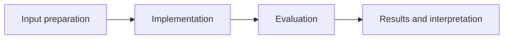

# Product Data Quality Workflow

**Feras Elghandour** · Technical case study

Turn incomplete product metadata into a consistent, filterable product shortlist and auditable exports.

## Implementation

A deterministic synthetic product/review fixture, missing-price handling, rating filters, guarded lookups, CSV/Parquet export, and exploratory pricing charts.



## Evidence and results

The saved run creates 100 synthetic metadata rows and retains 31 products after the initial quality filter, with 20 above the final rating cutoff. These are simulated records, not observed marketplace demand.

Results described as saved come from the retained experiment record. See [VALIDATION.md](VALIDATION.md) for the checks performed on this release and their scope.

## Fresh reproduction — October 17, 2026

Fresh execution reproduced the 31.0% initial retention rate on the generated fixture.

The environment versions, input hashes, and notebook hash are recorded in [results/reproduction.json](results/reproduction.json).


## Practical relevance

This project demonstrates a deterministic synthetic product/review fixture, missing-price handling, rating filters, guarded lookups, CSV/Parquet export, and exploratory pricing charts.
The implementation and evaluation make the trade-offs inspectable for technical review.

## Run locally

```sh
python -m venv .venv
source .venv/bin/activate
python -m pip install -r requirements.txt
jupyter lab analysis.ipynb
```

Prepare the inputs described in [DATA.md](DATA.md) first. Source validation is available without installing model dependencies:

```sh
python scripts/validate_source.py
```

## Limitations

The workflow demonstrates data handling rather than product recommendation effectiveness. Prices and reviews are generated examples; the project does not download real Amazon reviews.

## Development

Changes should include a clear description of the behavior affected and verification appropriate to that behavior. Keep input data, credentials, model caches, and generated artifacts outside version control.
