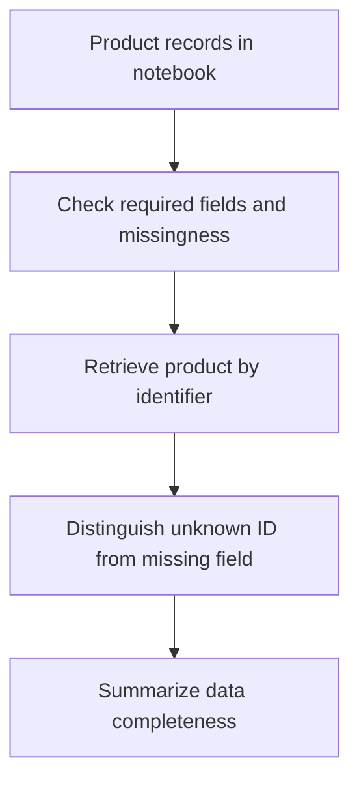
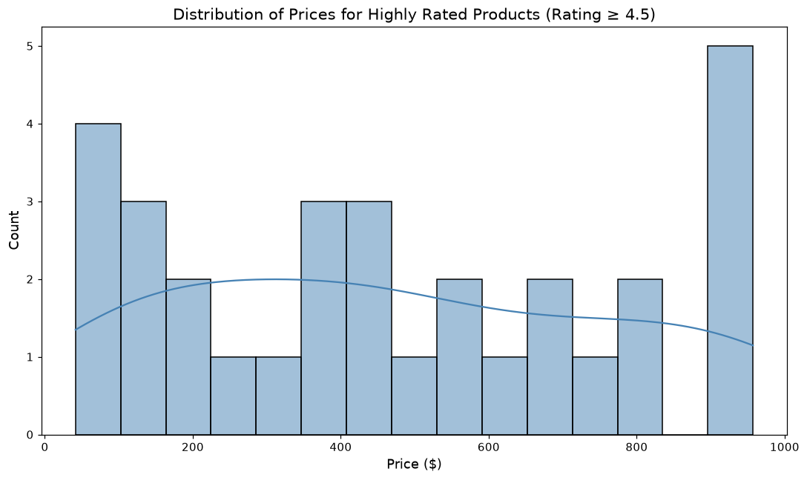

# Product Data Quality Workflow

Turn incomplete product metadata into a consistent, filterable product shortlist and auditable exports.

## Implementation

A deterministic synthetic product/review fixture, missing-price handling, rating filters, guarded lookups, CSV/Parquet export, and exploratory pricing charts.



## Try a small example

A small offline fixture exercises the public implementation. It demonstrates the behavior shown below; it does not replace the historical dataset, benchmark or production validation.

After the local setup below, run from the repository root:

```sh
python examples/quickstart.py
```

The [example source](examples/quickstart.py), [captured output](examples/expected-output.txt) and [execution record](examples/environment.json) keep this demonstration inspectable. Floating-point values may vary with library versions.

Observed output from this run:

```text
{
  "fixture": "two generated product records",
  "known": "Product 'Headphones' found! Price: $99.00",
  "missing_price": "Product 'Speaker' found but price is not available.",
  "unknown": "Error: Product with ASIN Z not found.",
  "retained_one_of_two_percent": 50.0
}
```

## Evidence and results

The saved run creates 100 synthetic metadata rows and retains 31 products after the initial quality filter, with 20 above the final rating cutoff. These are simulated records, not observed marketplace demand.

See [VALIDATION.md](VALIDATION.md) for the release checks and their scope.

## Fresh reproduction — October 17, 2026

Fresh execution reproduced the 31.0% initial retention rate on the generated fixture.

The environment versions, input hashes, and notebook hash are recorded in [results/reproduction.json](results/reproduction.json).



## Run locally

```sh
python -m venv .venv
source .venv/bin/activate
python -m pip install -r requirements.txt
jupyter lab analysis.ipynb
```

Prepare the inputs described in [DATA.md](DATA.md) first. Source validation is available without installing model dependencies:

```sh
python scripts/validate_source.py
```

## Limitations

The workflow demonstrates data handling rather than product recommendation effectiveness. Prices and reviews are generated examples; the project does not download real Amazon reviews.
